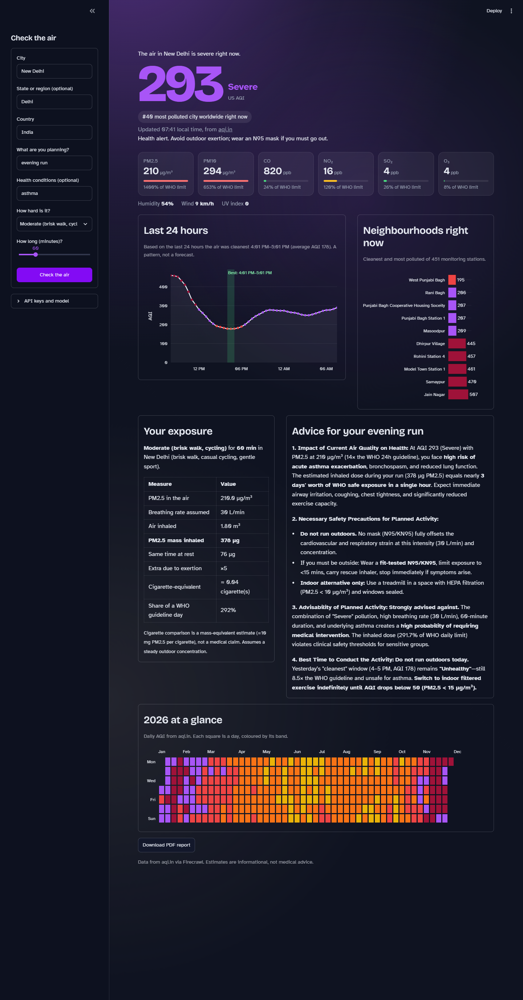

# 🌍 AQI Analysis Agent

Live air quality for any city on [aqi.in](https://www.aqi.in), turned into a clear picture and
personal health advice for what you plan to do outside.



Based on the AQI Analysis Agent from
[awesome-llm-apps](https://github.com/Shubhamsaboo/awesome-llm-apps) (original tutorial:
[theunwindai.com](https://www.theunwindai.com/p/build-an-aqi-analysis-agent)), redesigned and extended.

## What changed in this version

**New features**
- **Glowing AQI headline.** The page takes on the colour of the current air: green on a clean day,
  purple on a severe one, with a haze that thickens as pollution gets worse. It shows the AQI, its
  category, the city's world pollution rank and when aqi.in last updated it.
- **All six pollutants.** PM2.5, PM10, CO, NO₂, SO₂ and O₃ (the original showed three), each with a
  bar showing how far it is above or below the WHO guideline.
- **Last 24 hours + best time to go out.** A half-hourly chart from aqi.in with the cleanest daytime
  window for your activity highlighted (between 6 AM and 9 PM, as long as your activity). The AI
  advice uses that real window instead of guessing.
- **Cleanest and most polluted neighbourhoods.** Every monitoring station aqi.in lists for the city,
  ranked, so you can pick where to go.
- **The year at a glance.** A calendar heatmap of the daily AQI for every day this year.
- **Better PDF report** with every pollutant, the best window, the source page and update time.

**Reliability and correctness**
- **One fast scrape instead of a slow extract.** The app reads the aqi.in page once (≈1 Firecrawl
  credit, a few seconds) and parses it itself, instead of Firecrawl's `extract` on a wildcard URL.
- **Finds the right page.** It tries the likely aqi.in addresses, then searches aqi.in (Firecrawl
  map) — so "New York" lands on New York City — and checks the page really is the city you asked for.
- **Fresh data.** Firecrawl served hours-old cached copies by default; the app now asks for pages at
  most 10 minutes old, and keeps its own 30-minute cache so repeat checks are instant.
- **Correct AQI scale.** aqi.in reports US AQI; the original rated that number on India's CPCB scale,
  so Delhi's 260 showed as "Poor" instead of aqi.in's "Severe". Fixed.
- **Clear errors.** A misspelt city, a Firecrawl failure or an AI rate limit produce a plain message;
  readings and charts stay on screen when only the AI part fails. No more silent all-zero readings.

**Code quality**
- Shared logic lives in `aqi_core/` (fetching, parsing, AQI standards, timing, agent, report) and
  `aqi_ui/` (theme and charts) instead of being copied into both apps.
- 81 automated tests, run against real saved aqi.in pages (`tests/fixtures/`).

**Security**
- The Gradio app no longer opens a public link by default (set `GRADIO_SHARE=1` to opt in).
- Neither app shows your `.env` keys in the page; key fields are empty and fall back to `.env`.

## How it works

```
city, activity ──► find aqi.in page ──► Firecrawl scrape (markdown) ──► parser ──► AqiReading
                                                                                      │
             dark Streamlit UI ◄── charts + best window + dose estimate ◄────────────┤
                    ▲                                                                 │
                    └──────────── streamed advice ◄── agno agent (OpenRouter LLM) ◄───┘
```

| Folder / file | What it does |
|---|---|
| `aqi_core/locator.py`, `fetcher.py` | Find the aqi.in page, scrape it, validate, retry, cache |
| `aqi_core/parser.py` | Turn the page into an `AqiReading` (pollutants, 24h, stations, calendar) |
| `aqi_core/standards.py`, `timing.py` | AQI bands, WHO limits, inhaled dose, best time window |
| `aqi_core/agent.py`, `report.py` | AI health advice, PDF report |
| `aqi_ui/theme.py`, `charts.py` | Glowing dark theme and Plotly charts |
| `ai_aqi_analysis_agent_streamlit.py` | Main app |
| `ai_aqi_analysis_agent_gradio.py` | Classic Gradio app on the same core |

## How to run (Windows)

1. **Create a virtual environment.** This folder's path is very long, and Windows can't load some
   libraries from a venv inside it, so put the venv on a short path:
   ```powershell
   py -3.12 -m venv C:\Users\<you>\.venvs\aqi
   C:\Users\<you>\.venvs\aqi\Scripts\python -m pip install -r requirements.txt
   ```
   (On macOS/Linux a normal `python -m venv .venv` inside the project is fine.)

2. **Add your API keys.** Copy `.env.example` to `.env` and fill in:
   - `FIRECRAWL_API_KEY` from [firecrawl.dev](https://www.firecrawl.dev/app/api-keys)
   - `OPENROUTER_API_KEY` from [openrouter.ai/keys](https://openrouter.ai/keys)
   - optionally `OPENROUTER_MODEL` (any ID from [openrouter.ai/models](https://openrouter.ai/models))

   Never share or commit `.env`: it holds your keys.

3. **Start the app:**
   ```powershell
   C:\Users\<you>\.venvs\aqi\Scripts\python -m streamlit run ai_aqi_analysis_agent_streamlit.py
   ```
   It opens at http://localhost:8501. Try Delhi, Mumbai (Maharashtra), New York (United States)
   or Rabat (Morocco). Restart it after editing code in `aqi_core/` or `aqi_ui/`.

   The classic Gradio version: `C:\Users\<you>\.venvs\aqi\Scripts\python ai_aqi_analysis_agent_gradio.py`

4. **Run the tests:**
   ```powershell
   C:\Users\<you>\.venvs\aqi\Scripts\python -m pytest -q
   ```

## Notes

- Data comes only from aqi.in, which blocks plain automated requests; Firecrawl gets the page.
- "Best time" is the cleanest stretch of the **last** 24 hours: a daily pattern, not a forecast.
- The dose and cigarette comparisons are mass-based estimates for information, not medical advice.
